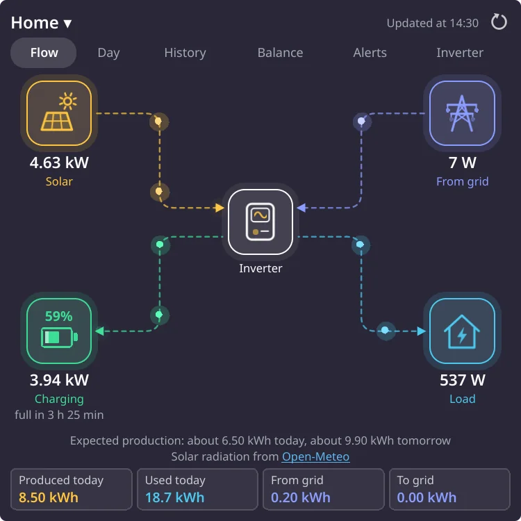

# Solar Now

A Plasma 6 widget that shows the live power flow of a solar installation monitored in Deye Cloud. It shows what the panels produce, what the battery does, what comes from or goes to the grid and what the house uses. Dots run along the lines in the direction the energy goes.

**Unofficial. Not made, endorsed or supported by Deye.**



## Tabs

- **Flow**: panels, battery, grid, load and inverter, with today's totals and how long the battery lasts (or how soon it is full)
- **Day**: the curves of the day, every 5 minutes, with the peaks of production and consumption
- **History**: energy by day, month or year: produced, used, to and from the battery and the grid
- **Balance**: where the consumption came from and where the production went; self-sufficiency and self-consumption
- **Alerts**: the alerts raised by the station
- **Inverter**: everything the inverter reports, in groups


## Also

- Panel view with the numbers you choose
- Desktop notifications: low battery, station stopped reporting, new alert
- Money: enter your prices per kWh to see what you saved, earned and paid
- Estimate of today's and tomorrow's production, learned from the last two weeks of your own installation and the solar radiation forecast by Open-Meteo (can be turned off)
- Several stations on one account: pick one from the header
- English and Romanian; follows the language of Plasma by default
- Colours, background, font, text size, units, animations and visible tabs are configurable

## What you need

- Plasma 6 (tested on Plasma 6.7)
- A Deye Cloud account with your installation in it
- Your own AppId and AppSecret: create an application in the [Deye Cloud Developer Portal](https://developer.deyecloud.com). Each user uses their own keys, under the Deye Cloud Developer Agreement.

## Install

From Plasma: right-click the desktop → **Add Widgets…** → **Get New Widgets…** → **Download New Plasma Widgets…**, then search for **Solar Now**. It is also on the [KDE Store](https://store.kde.org/p/2378759/).

From a release, with the `.plasmoid` file from the [releases page](https://github.com/oriceon/solar-now/releases):

```bash
kpackagetool6 --type Plasma/Applet --install solar-now-1.0.3.plasmoid
```

From this repository:

```bash
./install.sh --restart
```

`install.sh` installs or upgrades the widget from `package/`; `--restart` restarts Plasma, which otherwise keeps the old code in memory.

## Setup

In the widget's settings, choose the data centre, enter the AppId, the AppSecret, your e-mail (or user name) and password, press **Connect** and pick the station.

## Read only

The widget only reads data. It never sends commands to the inverter and never changes anything on the account. `tests/readonly.test.mjs` holds the list of the Deye Cloud endpoints the code may call, and fails when another one appears.

## Privacy

The widget talks only to Deye Cloud and, for the estimate, to Open-Meteo. Open-Meteo gets only the place of the station, rounded to about a kilometre. Nothing is sent anywhere else.

The AppSecret and the token (valid for 60 days) are kept unencrypted in the Plasma settings file. With **Remember the password** checked (off by default), the SHA-256 of the password is kept there too, so that the token renews by itself; Deye Cloud accepts it in place of the password.

## Development

The widget is plain QML, with no build step. What it computes lives in `package/contents/code/*.mjs`, modules without Qt, tested with Node:

```bash
node --test tests/*.test.mjs
```

`tests/qml/viewer.py` loads the QML in a real Qt engine (PySide6), with stand-ins for the Plasma and Kirigami modules, and saves a screenshot. It exits with 1 on any QML error or warning.

```bash
pip install PySide6-Essentials
export QT_QPA_PLATFORM=offscreen QT_QUICK_BACKEND=software
cd tests/qml
python viewer.py stage out.png --tab 1          # the interface, from recorded answers
python viewer.py applet out.png --mock --tab 1  # the whole widget, against a local stand-in for Deye Cloud
python viewer.py config out.png --page 0 --mock # a page of the settings
```

`tools/capture.mjs` asks Deye Cloud what the widget asks it, with a real account, and saves the answers in `tests/fixtures/real-*.json` with everything personal taken out. It only reads. `tools/store/make.sh` remakes the pictures for the KDE Store in `store/`, and `tools/store/animations.sh` the animations of this page; the latter needs Pillow (`pip install pillow`).

## Credits and licence

Solar radiation data: [Open-Meteo](https://open-meteo.com), CC BY 4.0. The fonts in `tools/store/fonts/` are Noto Sans, under the SIL Open Font License.

Solar Now is free software, under the GNU General Public License, version 2 or later. See [LICENSE](LICENSE).
